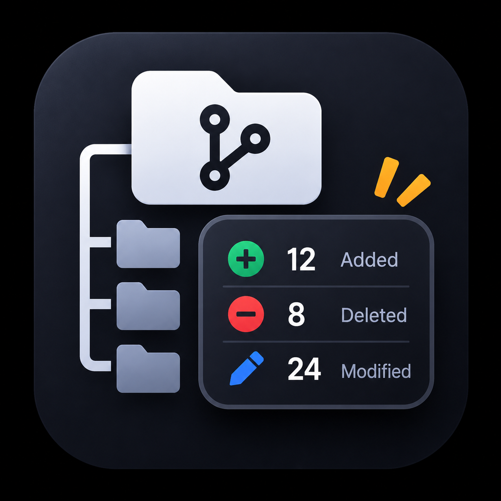

# Monorepo Git Status

<div align="center">
  
  
  <p>一个 JetBrains IDE 插件，用于在项目视图中直接显示 monorepo 项目中各个目录的 Git 变更统计。</p>
  
  <p>
    
    
    
  </p>
  
  <p>
    <a href="./README_EN.md">English</a> | 简体中文
  </p>
</div>

## ✨ 功能特性

- **彩色 Git 状态显示**：在项目视图的目录名旁显示变更统计
  - ~蓝色 表示修改的文件
  - +红色 表示新增的文件
  - -灰色 表示删除的文件
- **自动检测**：自动检测并监控常见的 monorepo 结构
  - `packages/*`
  - `apps/*`
  - `services/*`
- **实时更新**：检测到 VCS 变更时自动刷新
- **可配置**：手动添加或删除要监控的目录
- **轻量级**：对性能影响极小

## 📸 效果预览

```
services/
  ├─ balance       ~1/+0/-0
  ├─ bill_service  ~0/+2/-1
  └─ user_service  ~3/+1/-0
```

## 🚀 安装

### 从 JetBrains Marketplace 安装（推荐）

1. 打开你的 JetBrains IDE（IntelliJ IDEA、GoLand、WebStorm 等）
2. 进入 **Settings/Preferences** → **Plugins** → **Marketplace**
3. 搜索 "**Monorepo Git Status**"
4. 点击 **Install** 并重启 IDE

### 手动安装

1. 从 [Releases](https://github.com/liangzhaoliang95/monorepo-git-status/releases) 下载最新版本
2. 进入 **Settings/Preferences** → **Plugins** → **⚙️** → **Install Plugin from Disk**
3. 选择下载的 ZIP 文件
4. 重启 IDE

## 📖 使用说明

### 自动检测

安装后，插件会自动检测以下目录：
- `packages/*`
- `apps/*`
- `services/*`

Git 状态会显示在这些目录旁边的项目视图中。

### 手动配置

1. 进入 **Settings/Preferences** → **Tools** → **Monorepo Git Status**
2. 点击 **Add Directory** 添加要监控的目录
3. 输入相对路径（例如：`libs/shared`）
4. 输入显示名称（可选）
5. 点击 **OK** 保存

### 理解显示格式

格式为：`~修改数/+新增数/-删除数`

- **~**（蓝色）：修改或未跟踪的文件
- **+**（红色）：新增/暂存的文件
- **-**（灰色）：删除的文件

示例：`~3/+1/-0` 表示 3 个修改、1 个新增、0 个删除

## 🛠️ 配置

| 设置项 | 说明 | 默认值 |
|--------|------|--------|
| 目录列表 | 要监控的目录列表 | 自动检测 |
| 刷新间隔 | 刷新频率（秒） | 30 |

## 💡 使用场景

非常适合：
- **Monorepo 项目**：快速查看哪些包有变更
- **微服务架构**：监控一个仓库中的多个服务
- **大型团队**：了解活跃的开发区域
- **代码审查**：识别哪些子项目受到影响

## 🔧 开发

### 从源码构建

```bash
git clone https://github.com/liangzhaoliang95/monorepo-git-status.git
cd monorepo-git-status
./gradlew buildPlugin
```

构建的插件位于 `build/distributions/` 目录。

### 环境要求

- JDK 17+
- Gradle 8.2+
- IntelliJ Platform SDK

### 使用 Makefile

```bash
# 本地构建
make build

# 创建并推送标签（触发自动发布）
make release VERSION=1.0.9

# 查看帮助
make help
```

## 📝 更新日志

### 1.0.8 (2026-11-16)
- 首次发布
- 项目视图中彩色显示 Git 状态
- 自动检测 monorepo 结构
- 可配置目录监控
- VCS 变更时实时更新

## 🤝 贡献

欢迎贡献！请随时提交 Pull Request。

1. Fork 本仓库
2. 创建特性分支 (`git checkout -b feature/AmazingFeature`)
3. 提交更改 (`git commit -m 'Add some AmazingFeature'`)
4. 推送到分支 (`git push origin feature/AmazingFeature`)
5. 创建 Pull Request

## 📄 许可证

本项目采用 MIT 许可证 - 详见 [LICENSE](LICENSE) 文件。

## 🙏 致谢

- 灵感来自 [GitToolBox](https://plugins.jetbrains.com/plugin/7499-gittoolbox)
- 基于 [IntelliJ Platform Plugin SDK](https://plugins.jetbrains.com/docs/intellij/welcome.html) 构建

## 📧 支持

- **问题反馈**：[GitHub Issues](https://github.com/liangzhaoliang95/monorepo-git-status/issues)
- **电子邮件**：liangzhaoliang95@163.com

---

❤️ 由 [liangzhaoliang95](https://github.com/liangzhaoliang95) 用心打造
