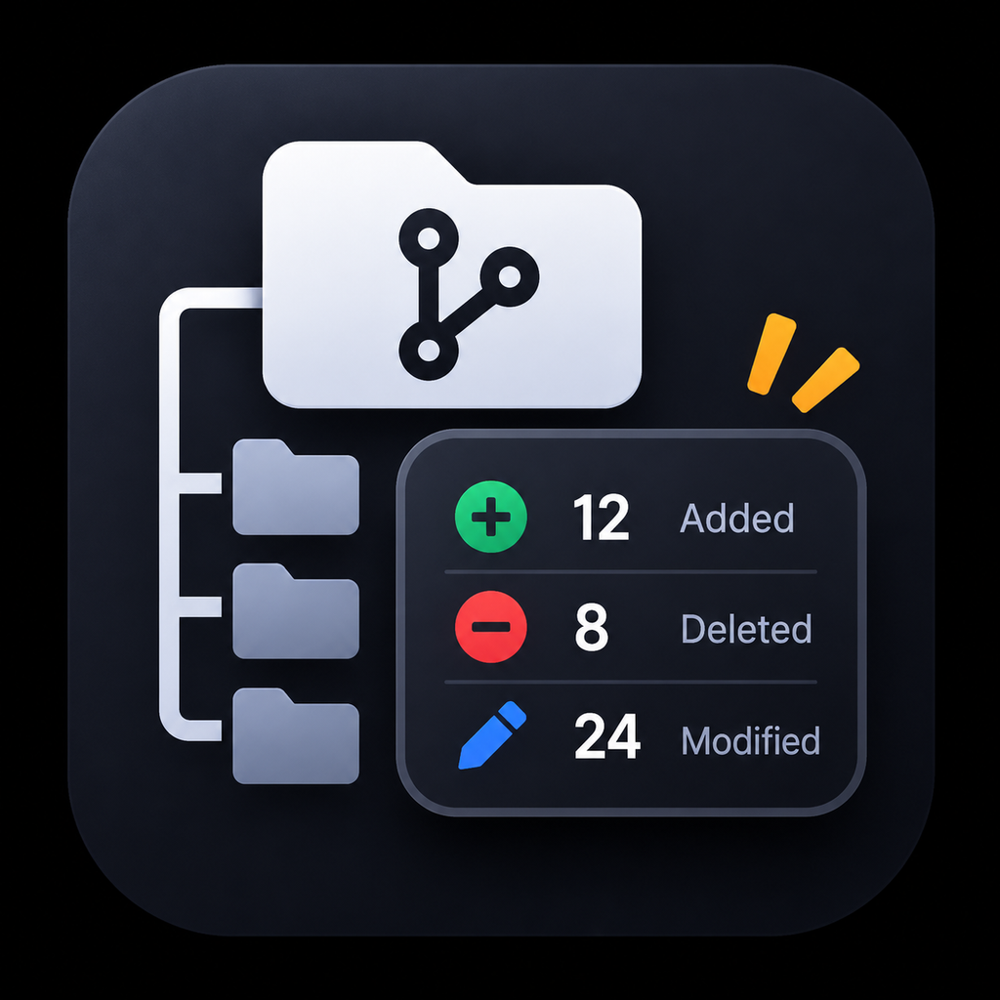

# Monorepo Git Status

<div align="center">
  
  
  <p>A JetBrains IDE plugin that displays Git change statistics for directories in monorepo projects, directly in the Project View.</p>
  
  <p>
    
    
    
  </p>
  
  <p>
    English | <a href="./README.md">简体中文</a>
  </p>
</div>

## ✨ Features

- **Colorful Git Status Display**: Shows change counts next to directory names in the Project View
  - ~blue for modified files
  - +red for added files  
  - -gray for deleted files
- **Auto-Detection**: Automatically detects and monitors common monorepo structures
  - `packages/*`
  - `apps/*`
  - `services/*`
- **Real-time Updates**: Automatically refreshes when VCS changes are detected
- **Configurable**: Manually add or remove directories to monitor
- **Lightweight**: Minimal performance impact

## 📸 Screenshots

```
services/
  ├─ balance       ~1/+0/-0
  ├─ bill_service  ~0/+2/-1
  └─ user_service  ~3/+1/-0
```

## 🚀 Installation

### From JetBrains Marketplace (Recommended)

1. Open your JetBrains IDE (IntelliJ IDEA, GoLand, WebStorm, etc.)
2. Go to **Settings/Preferences** → **Plugins** → **Marketplace**
3. Search for "**Monorepo Git Status**"
4. Click **Install** and restart your IDE

### Manual Installation

1. Download the latest release from [Releases](https://github.com/liangzhaoliang95/monorepo-git-status/releases)
2. Go to **Settings/Preferences** → **Plugins** → **⚙️** → **Install Plugin from Disk**
3. Select the downloaded ZIP file
4. Restart your IDE

## 📖 Usage

### Automatic Detection

After installation, the plugin will automatically detect directories under:
- `packages/*`
- `apps/*`
- `services/*`

Git status will appear next to these directories in the Project View.

### Manual Configuration

1. Go to **Settings/Preferences** → **Tools** → **Monorepo Git Status**
2. Click **Add Directory** to add a directory to monitor
3. Enter the relative path (e.g., `libs/shared`)
4. Enter a display name (optional)
5. Click **OK** to save

### Understanding the Display

The format is: `~modified/+added/-deleted`

- **~** (blue): Modified or untracked files
- **+** (red): Added/staged files
- **-** (gray): Deleted files

Example: `~3/+1/-0` means 3 modified, 1 added, 0 deleted files

## 🛠️ Configuration

| Setting | Description | Default |
|---------|-------------|---------|
| Directories | List of directories to monitor | Auto-detected |
| Refresh Interval | How often to refresh (seconds) | 30 |

## 💡 Use Cases

Perfect for:
- **Monorepo Projects**: Quickly see which packages have changes
- **Microservices**: Monitor multiple services in one repository
- **Large Teams**: Get overview of active development areas
- **Code Reviews**: Identify which sub-projects are affected

## 🔧 Development

### Building from Source

```bash
git clone https://github.com/liangzhaoliang95/monorepo-git-status.git
cd monorepo-git-status
./gradlew buildPlugin
```

The built plugin will be in `build/distributions/`.

### Requirements

- JDK 17+
- Gradle 8.2+
- IntelliJ Platform SDK

### Using Makefile

```bash
# Build locally
make build

# Create and push tag (triggers auto-release)
make release VERSION=1.0.9

# Show help
make help
```

## 📝 Changelog

### 1.0.8 (2026-11-16)
- Initial release
- Colorful Git status display in Project View
- Auto-detection of monorepo structures
- Configurable directory monitoring
- Real-time updates on VCS changes

## 🤝 Contributing

Contributions are welcome! Please feel free to submit a Pull Request.

1. Fork the repository
2. Create your feature branch (`git checkout -b feature/AmazingFeature`)
3. Commit your changes (`git commit -m 'Add some AmazingFeature'`)
4. Push to the branch (`git push origin feature/AmazingFeature`)
5. Open a Pull Request

## 📄 License

This project is licensed under the MIT License - see the [LICENSE](LICENSE) file for details.

## 🙏 Acknowledgments

- Inspired by [GitToolBox](https://plugins.jetbrains.com/plugin/7499-gittoolbox)
- Built with [IntelliJ Platform Plugin SDK](https://plugins.jetbrains.com/docs/intellij/welcome.html)

## 📧 Support

- **Issues**: [GitHub Issues](https://github.com/liangzhaoliang95/monorepo-git-status/issues)
- **Email**: liangzhaoliang95@163.com

---

Made with ❤️ by [liangzhaoliang95](https://github.com/liangzhaoliang95)
